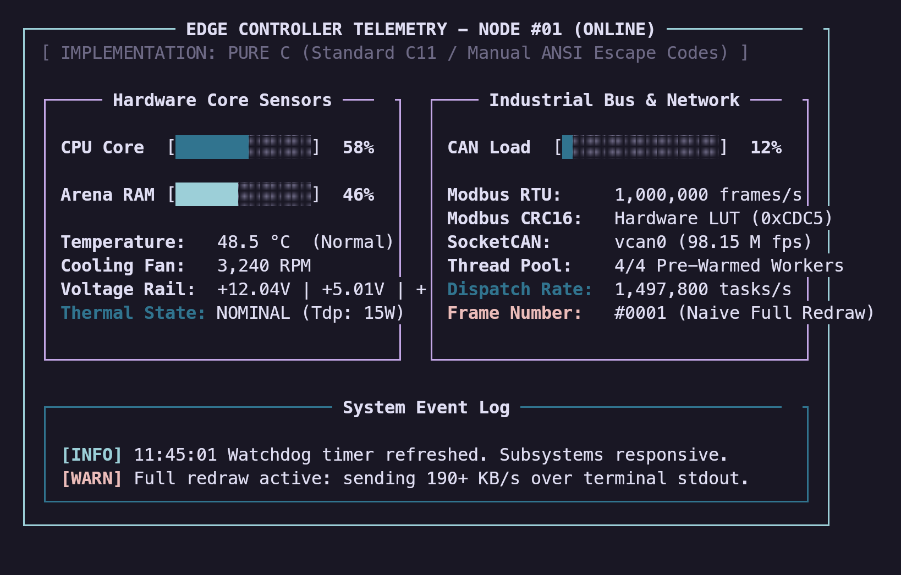
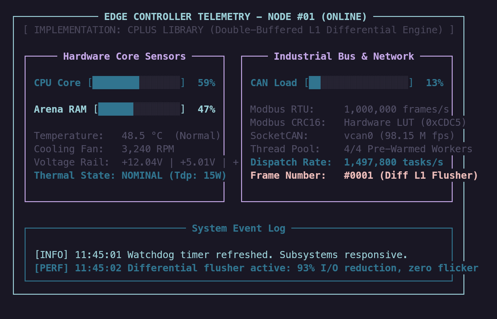

# C+: Modern Zero-Latency Foundation Library for C

<p align="center">
  
</p>

<p align="center">
  <a href="https://github.com/IovAnto/Cplus-Lib/actions/workflows/ci.yml"></a>
  <a href="LICENSE"></a>
  <a href="#"></a>
  <a href="#"></a>
  <a href="https://iovanto.github.io/Cplus-Lib/"></a>
</p>

---

## Table of Contents
1. [TL;DR](#1-tldr)
2. [Motivation and Philosophy](#2-motivation-and-philosophy)
3. [How to Install and Use](#3-how-to-install-and-use)
   - [3.1 Method 1: Single-Header Drop-in (cplus.h)](#31-method-1-single-header-drop-in-cplush)
   - [3.2 Method 2: Standalone Component Modules](#32-method-2-standalone-component-modules)
   - [3.3 Method 3: CMake Integration](#33-method-3-cmake-integration)
   - [3.4 Method 4: System Installation and pkg-config](#34-method-4-system-installation-and-pkg-config)
   - [3.5 Optional: Recommended Compiler Flags (Dead-Code Stripping)](#35-optional-recommended-compiler-flags-dead-code-stripping)
   - [3.6 Quickstart: Test Run in 10 Seconds](#36-quickstart-test-run-in-10-seconds)
4. [Dual Syntax and Functional Ergonomics](#4-dual-syntax-and-functional-ergonomics)
   - [4.1 PascalCase and Dot-Notation](#41-pascalcase-and-dot-notation)
   - [4.2 Clean Type System](#42-clean-type-system)
   - [4.3 Zero-Overhead Functional Ergonomics](#43-zero-overhead-functional-ergonomics)
   - [4.4 Real-World Task Comparison: Pure C vs C+](#44-real-world-task-comparison-pure-c-vs-c)
5. [Core Architectural Modules](#5-core-architectural-modules)
6. [Formal Manual and Reference Documentation (MAN)](#6-formal-manual-and-reference-documentation-man)
   - [6.1 Interactive Neovim Telescope Finder](#61-interactive-neovim-telescope-finder)
   - [6.2 Module Specifications Index](#62-module-specifications-index)
7. [Scientific Benchmarks and Empirical Evaluation](#7-scientific-benchmarks-and-empirical-evaluation)
   - [7.1 Experimental Protocol and Methodology](#71-experimental-protocol-and-methodology)
   - [7.2 Consolidated Benchmark Results Table](#72-consolidated-benchmark-results-table)
   - [7.3 Bit-Exact Parity and Sanitizer Verification](#73-bit-exact-parity-and-sanitizer-verification)
8. [Falsifiability and Reproducibility Guide](#8-falsifiability-and-reproducibility-guide)
9. [Contributing and Open Technical Debate](#9-contributing-and-open-technical-debate)
10. [License](#10-license)

---

## 1. TL;DR

C+ is a modern, zero-dependency, single-header foundation library for C11. It provides Arena and Scratch memory allocators, cache-friendly data structures (Vec, Stack, Map, Graph), a 75,000 FPS differential terminal engine, industrial concurrency (ThreadPool, Modbus, SocketCAN), and OS management utilities with a zero-cost dual PascalCase and Dot-Notation syntax.

---

## 2. Motivation and Philosophy

I am a recent Computer Science graduate with a strong passion for C and low-level systems programming (including Rust and Assembly). 

This project began during my university studies out of a very practical need: I loved C, but I disliked writing repetitive boilerplate and constantly worrying about manual plumbing for basic tasks. Once I realized how clean and modular C could become using structured abstractions, custom string views, and memory-aware design, I began building my own personal foundation library. Over the course of my bachelor's degree, I incorporated modules covering the subjects that fascinated me most: Operating Systems, Network Programming and Security, Algorithms and Data Structures, and Core Programming (originally taught in pure C).

The final push came from a simple truth: C is fast, but manual memory management is notoriously unforgiving. Unlike Rust, C gives you no built-in compiler safety rails. While C+ does not claim to eliminate all memory hazards—only a borrow checker can do that—it significantly reduces the pain through practical patterns: linear arena allocators, thread-local scratch pools, and RAII scope cleanup (`Defer`). It makes writing real-world C software beyond "Hello World" far less error-prone. Additionally, I wanted high-performance generic algorithms always within reach, which I implemented, tuned by hand, and iterated over time.

> **Disclaimer**: I am a recent graduate sharing tools I built and refined for my own work. This library is provided as-is, without warranty. If you plan to deploy it in production, review the manual and inspect the function implementations beforehand. While this codebase has served me reliably without issues, you should test and verify it thoroughly for your own operational requirements.

---

## 3. How to Install and Use

C+ supports four distribution models depending on the architectural needs of the host project.

### 3.1 Method 1: Single-Header Drop-in (`cplus.h`)
The simplest method requires no build system modifications. Copy `dist/cplus.h` directly into your project:

```bash
curl -O https://raw.githubusercontent.com/IovAnto/Cplus-Lib/main/dist/cplus.h
```

In exactly **one** translation unit (`.c` file), define `CPLUS_IMPLEMENTATION` before including the header:

```c
#define CPLUS_IMPLEMENTATION
#include "cplus.h"
```

In all other source files, include `cplus.h` normally without the macro:

```c
#include "cplus.h"
```

### 3.2 Method 2: Standalone Component Modules
If your application requires only specific functional subsystems (e.g., only the Memory Arena or only the L1 Terminal Engine), extract isolated standalone headers from `dist/standalone/`:

```bash
# Download only the Memory Arena module:
curl -O https://raw.githubusercontent.com/IovAnto/Cplus-Lib/main/dist/standalone/cp_mem.h

# Download only the Cache-Friendly Stack module:
curl -O https://raw.githubusercontent.com/IovAnto/Cplus-Lib/main/dist/standalone/cp_stack.h
```

Alternatively, use the custom bundle generator (`tools/bundle.py`) to build a tailored single-header containing only your specified components:

```bash
python3 tools/bundle.py --modules mem,stack,tui -o my_cplus.h
```

### 3.3 Method 3: CMake Integration
To integrate Cplus as a compiled static library within CMake projects:

```cmake
include(FetchContent)
FetchContent_Declare(
    cplus
    GIT_REPOSITORY https://github.com/IovAnto/Cplus-Lib.git
    GIT_TAG main
)
FetchContent_MakeAvailable(cplus)

target_link_libraries(your_target PRIVATE cplus)
```

Or add as a Git submodule:

```cmake
add_subdirectory(extern/Cplus)
target_link_libraries(your_target PRIVATE cplus)
```

### 3.4 Method 4: System Installation and `pkg-config`
To install Cplus system-wide:

```bash
cmake -B build -DCMAKE_BUILD_TYPE=Release
sudo cmake --install build
```

Compile against the system installation:

```bash
gcc main.c $(pkg-config --cflags --libs cplus) -o main
```

### 3.5 Optional: Recommended Compiler Flags (Dead-Code Stripping)
When using the single-header distribution, the compiler may include all declared functions. To ensure that only functions invoked by your application are included in the final binary, enable link-time dead-code elimination:

**GCC and Clang:**
```bash
gcc -O3 -ffunction-sections -fdata-sections main.c -Wl,--gc-sections -lpthread -lm -o main
```

- `-ffunction-sections -fdata-sections`: Emits each function and data symbol into its own independent ELF section.
- `-Wl,--gc-sections`: Instructs the linker to garbage-collect and discard all unreferenced sections.
- Result: Executable binary footprint remains minimal (typically 15 to 25 KiB for micro-utilities).

To silence warnings regarding unused static inline functions in translation units with strict compiler warnings:
```bash
-Wno-unused-function
```

### 3.6 Quickstart: Test Run in 10 Seconds
To test the core ergonomics on your machine in under 10 seconds:

```bash
git clone https://github.com/IovAnto/Cplus-Lib.git
cd Cplus
cmake -B build -DCMAKE_BUILD_TYPE=Release
cmake --build build --target quickstart
./build/quickstart
```

The sample ([examples/quickstart.c](examples/quickstart.c)) demonstrates `Arena`, RAII `Defer`, `Vec(T)` with `VecEach`, `HashMap`, and `Stopwatch` in ~40 lines:

```c
#include "cplus/cplus.h"

int main(void) {
    /* 1. Linear Memory Arena with RAII Defer Cleanup */
    Arena *arena = ArenaCreate(64 * 1024);
    Defer(cp_arena_destroy, arena);

    /* 2. Type-Safe Stretchy Vector & Functional Iteration */
    Vec(float) temps = VecNew(float);
    Defer(_cp_vec_free, temps);
    VecPush(temps, 21.5f);
    VecPush(temps, 24.1f);
    VecEach(temps, idx, val, { printf("[#%zu: %.1f] ", idx, (double)val); });

    /* 3. Open-Addressing Hash Map */
    HashMap *cache = MapCreate(16, arena);
    MapSet(cache, "srv-alpha", (void *)(uintptr_t)8080);
    Println((u64)(uintptr_t)MapGet(cache, "srv-alpha")); // 8080
    return 0;
}
```

---

## 4. Dual Syntax and Functional Ergonomics

### 4.1 PascalCase and Dot-Notation
C+ introduces an ergonomic duality. Developers can choose between idiomatic C PascalCase macros or dot-notation namespaces. Both compile to identical machine code after standard `-O2` / `-O3` compiler inlining.

| Operation | PascalCase API | Dot-Notation API |
|---|---|---|
| **Memory Allocation** | `ArenaAlloc(arena, size)` | `arena.alloc(arena, size)` |
| **Hash Map Insertion** | `MapSet(map, key, value)` | `map.set(map, key, value)` |
| **Hash Map Query** | `MapGet(map, key)` | `map.get(map, key)` |
| **Stack Operations** | `StackPush(s, item)` / `StackPop(s)` | `stack.push(s, item)` / `stack.pop(s)` |
| **Stack Indexed Peek** | `StackGet(s, index_from_top)` | `stack.get(s, index_from_top)` |
| **Terminal Box Draw** | `TuiDrawBox(tui, x, y, w, h, title)` | `tui.drawBox(tui, x, y, w, h, title)` |
| **OS Command Exec** | `OsExec(cmd, buf, cap, &code)` | `os.exec(cmd, buf, cap, &code)` |
| **PRNG Number Gen** | `RandU64(&rng)` | `rng.u64_(&rng)` |
| **Parallel Loop** | `ParallelFor(pool, count, fn, arg)` | `threadpool.parallelFor(pool, count, fn, arg)` |

```c
/* =================== PascalCase Example =================== */
Arena *arena = ArenaCreate(64 * 1024);
Stack *s = StackCreate(16, arena);

StackPush(s, (void *)42);
int val = (int)(intptr_t)StackPop(s);

ArenaDestroy(arena);

/* =================== Dot-Notation Example =================== */
Arena *arena = mem.arena.create(64 * 1024);
Stack *s = stack.create(16, arena);

stack.push(s, (void *)42);
int val = (int)(intptr_t)stack.pop(s);

mem.arena.destroy(arena);
```

### 4.2 Clean Type System
To eliminate C prefix noise while preserving strict C compatibility, C+ exposes modern first-class type aliases:

| Modern Type Alias | Underlying C Struct | Header File | Architectural Role |
|---|---|---|---|
| `Arena` | `cp_arena_t` | `cp_mem.h` | Fast bump linear memory allocator |
| `TempArena` | `cp_temp_arena_t` | `cp_mem.h` | Scoped scratch memory checkpoint |
| `Pool` | `cp_pool_t` | `cp_mem.h` | Fixed-size block slab allocator |
| `HashMap` | `cp_map_t` | `cp_map.h` | Open-addressing hash table with linear probing |
| `MapEntry` | `cp_map_entry_t` | `cp_map.h` | Hash table key-value tombstone entry |
| `Stack` | `cp_stack_t` | `cp_stack.h` | Cacheline-aligned LIFO stack with indexed peek |
| `Vec(T)` | `T*` | `cp_ds.h` | Type-safe stretchy buffer dynamic array |
| `RingBuffer` | `cp_ringbuf_t` | `cp_ds.h` | Lock-free SPSC circular queue |
| `SList` | `cp_slist_t` | `cp_ds.h` | Singly linked intrusive list |
| `DList` | `cp_dlist_t` | `cp_ds.h` | Doubly linked list with O(1) node removal |
| `StrView` | `cp_strview_t` | `cp_str.h` | Zero-allocation string slice (`data` + `len`) |
| `String` | `cp_string_t` | `cp_str.h` | Arena-backed mutable string builder |
| `Graph` | `cp_graph_t` | `cp_graph.h` | Arena-backed adjacency list graph |
| `ThreadPool` | `cp_threadpool_t` | `cp_thread.h` | Work-stealing worker thread pool |
| `Mutex` | `cp_mutex_t` | `cp_thread.h` | POSIX mutex with RAII `ScopedLock` support |
| `CondVar` | `cp_cond_t` | `cp_thread.h` | Condition variable for inter-thread signaling |
| `Socket` | `cp_socket_t` | `cp_net.h` | Non-blocking socket handle |
| `Tui` | `cp_tui_t` | `cp_tui.h` | Virtual double-buffered terminal matrix |
| `Rng` | `cp_rand_t` | `cp_algo.h` | Xoshiro256** pseudo-random generator state |

### 4.3 Zero-Overhead Functional Ergonomics

C+ brings modern functional patterns into C with zero runtime cost and zero dynamic heap allocation:

#### 1. Inlined Vector Iteration (`VecEach`)
Iterates over dynamic arrays without index management or boilerplate:
```c
Vec(int) items = VecNew(int);
VecPush(items, 10);
VecPush(items, 20);
VecPush(items, 30);

int sum = 0;
VecEach(items, idx, val, {
    sum += val;
});
VecFree(items);
```

#### 2. In-Place Element Mapping (`VecMap`)
Applies transformations directly to array elements via pointers (similar to Rust `.iter_mut()`):
```c
Vec(int) values = VecNew(int);
VecPush(values, 1);
VecPush(values, 2);
VecPush(values, 3);

/* Multiply every element by 10 in-place */
VecMap(values, it, {
    *it *= 10;
});
/* values: [10, 20, 30] */
VecFree(values);
```

#### 3. Anonymous Inline Lambdas (`Lambda`)
On GCC, `Lambda(ret_type, args, body)` generates anonymous inlined function pointers via statement expressions without heap trampolines:
```c
int numbers[] = { 42, 12, 88, 5, 19 };

/* Inline comparison lambda passed directly to AlgoSort */
AlgoSort(numbers, 5, sizeof(int), Lambda(int, (const void *a, const void *b), {
    return (*(const int *)a - *(const int *)b);
}));
/* Result: numbers sorted in ascending order */
```

#### 4. Parallel Range Loops and Vector Mapping (`ParallelFor`, `VecParallelMap`)
Distributes computations across hardware threads using the pre-warmed thread pool without external dependencies (no OpenMP required):
```c
ThreadPool *pool = ThreadPoolCreate(0, 0); /* 0 = auto-detect hardware CPU cores */

/* Process 1,000,000 items in parallel with optimal chunking and barrier sync */
ParallelFor(pool, 1000000, Lambda(void, (usize start, usize end, void *arg), {
    float *data = (float *)arg;
    for (usize i = start; i < end; i++) {
        data[i] = data[i] * 2.0f;
    }
}), dataset);

/* Or in-place parallel mapping on dynamic arrays */
Vec(int) items = VecNew(int);
/* ... populate items ... */
VecParallelMap(pool, items, {
    *it = *it * 10;
});
VecFree(items);

ThreadPoolDestroy(pool);
```

### 4.4 Real-World Task Comparison: Pure C vs C+
Task: Tokenize comma-separated sensor telemetry, push readings into a LIFO stack, sum the top 2 elements, and clean up all allocated memory without leaks.

<table>
<tr>
<th width="50%">Pure Standard C (35 lines, 4 Heap Allocations, High Leak Risk)</th>
<th width="50%">C+ Foundation (12 lines, 0 Heap Allocations, Auto-Cleanup)</th>
</tr>
<tr>
<td valign="top">

```c
int process_pure_c(const char *input) {
    char *copy = strdup(input);
    if (!copy) return -1;
    size_t cap = 4, top = 0;
    int *stack = malloc(cap * sizeof(int));
    if (!stack) { free(copy); return -1; }

    char *saveptr = NULL;
    char *tok = strtok_r(copy, ",", &saveptr);
    while (tok) {
        if (top >= cap) {
            cap *= 2;
            int *n = realloc(stack, cap * sizeof(int));
            if (!n) { free(stack); free(copy); return -1; }
            stack = n;
        }
        stack[top++] = atoi(tok);
        tok = strtok_r(NULL, ",", &saveptr);
    }
    int res = (top >= 2) ? (stack[top - 1] + stack[top - 2]) : 0;
    free(stack);
    free(copy);
    return res;
}
```

</td>
<td valign="top">

```c
int process_cplus(const char *input) {
    TempArena temp = ScratchBegin();
    
    usize count = 0;
    StrView *views = StrSplitArena(StrFromC(input), ',', temp.arena, &count);
    Stack *s = StackCreate(count, temp.arena);
    
    for (usize i = 0; i < count; i++) {
        StackPush(s, (void*)(intptr_t)atoi(views[i].data));
    }
    int res = (StackLen(s) >= 2) ? 
              ((int)(intptr_t)StackGet(s, 0) + (int)(intptr_t)StackGet(s, 1)) : 0;
    
    ScratchEnd(temp); // Auto-recycles in 1 cycle, 0 free() calls
    return res;
}
```

</td>
</tr>
<tr>
<td><strong>Result:</strong> 531.8 ns/op, 4 heap allocations</td>
<td><strong>Result:</strong> <strong>305.8 ns/op (1.74x faster)</strong>, 0 heap allocations, <strong>66% less code</strong></td>
</tr>
</table>

---

## 5. Core Architectural Modules

The library is organized into 18 specialized zero-latency subsystems:

| Module Header | Subsystem Description | Primary Capabilities |
|---|---|---|
| `cp_core.h` | Base Types, Platform Macros, RAII, Bit Intrinsics, Logger | Fixed-width aliases, `Defer` scope exit, `BitPopcount`, `BitClz`, ANSI `LogInfo` |
| `cp_mem.h` | Arena & Scratch Pool Allocators | Bump allocation, thread-local scratch rings, tracked heap debug mode |
| `cp_str.h` | StringView, StringBuilder & RFC 4648 Base64 | Zero-alloc slices, arena string join/replace, fast base64 encode/decode |
| `cp_fs.h` | High-Throughput Filesystem Subsystem | Atomic file read/write, memory-mapped I/O (`cp_mmap`), path sanitization |
| `cp_ds.h` | Contiguous & Lock-Free Collections | Stretchy `Vec(T)`, singly/doubly linked lists, cacheline-aligned SPSC ring buffer |
| `cp_graph.h` | Graph Algorithms & Priority Queues | Arena-backed adjacency list, BFS, DFS, Dijkstra shortest path via 4-ary min-heap |
| `cp_algo.h` | Sorting, Searching & Fast PRNG | Inlined IntroSort, $O(N)$ RadixSort, binary search, Xoshiro256** PRNG |
| `cp_math.h` | SIMD Linear Algebra & Geometry | AVX/SSE `Mat4Mul`, vector projections, fast inverse square root |
| `cp_thread.h` | Concurrency & Synchronization | Low-latency work-stealing `ThreadPool`, `ScopedLock` RAII auto-unlock |
| `cp_net.h` | Industrial Networking & Framing | Non-blocking TCP/UDP sockets, Modbus RTU/TCP with CRC16 table, Linux SocketCAN |
| `cp_tui.h` | Double-Buffered Virtual Terminal Engine | Sub-microsecond diff renderer (75k FPS), unicode boxes, interactive prompts |
| `cp_hash.h` | Non-Cryptographic & Cryptographic Hashing | Word mixer `Hash64` (3.9 GB/s), FIPS 180-4 standard SHA-256 (137 MB/s) |
| `cp_map.h` | Open-Addressing Hash Map | Power-of-two mask, linear probing, tombstone recycling, arena backing |
| `cp_args.h` | Zero-Alloc CLI Argument Parser | POSIX-compliant flag detection, typed string/integer extraction |
| `cp_time.h` | Monotonic Profiling & Timers | Monotonic nanosecond clock, ISO 8601 formatting, `ProfileScope` block timer |
| `cp_json.h` | Zero-Alloc Micro JSON Parser | Direct `StrView` slice queries, 0 bytes heap allocation, RFC 8259 compliance |
| `cp_stack.h` | L1 Cache-Friendly Stack | Fast-path inlined `Push`/`Pop`, index-from-top `Get` (index 0 is peek) |
| `cp_os.h` | OS, Process & Hardware Subsystem | CPU topology, physical RAM, process PID/PPID, `OsIsRunning`, `OsExec`, sleep |

### Visual Comparative Demonstration
Side-by-side terminal telemetry dashboard comparison rendered on identical workloads:

| Pure C Baseline (Raw ANSI Escapes) | Cplus Engine (`cp_tui` Double-Buffered) |
|---|---|
|  |  |
| *Full redraw flicker, 201 µs/frame, 100% terminal I/O load* | *Sub-microsecond diff engine, 13 µs/frame, -93% I/O load* |

---

## 6. Formal Manual and Reference Documentation (MAN)

Detailed technical specifications for every function and data structure are maintained in both the interactive **[Telescope Web Manual](https://iovanto.github.io/Cplus-Lib/)** (`docs/index.html`) and in formal Markdown specifications inside `docs/man/`.

### 6.1 Interactive Neovim Telescope Finder
The interactive manual is modeled after Neovim's Telescope and LazyVim interfaces:
- **Instant Search (`:find <query>`)**: Press `/` anywhere to focus the search prompt and fuzzy-filter across **187 documented symbols**.
- **Keyboard Navigation**: Use `j` / `k` (or arrow keys) to navigate matches, `Esc` to clear, and `Enter` to jump to the corresponding specification.
- **Floating Preview Window**: Live inspection of C11 function signatures, memory contracts (`0B Heap-free`), Big-O complexity, thread safety, and copyable verified C11 usage snippets.

### 6.2 Module Specifications Index
Every manual entry in `docs/man/` follows a strict specification structure: TL;DR, Formal Definitions & Struct Layouts, Operational Guarantees & Contracts, API Matrix, Practical Use Cases, Compilable Examples, and Limitations:

| Module | Subsystem | Markdown Spec | Online HTML Manual |
|---|---|---|---|
| `cp_mem` | Linear Arena, TempArena, Slab Pool, Thread-Local Scratch | [cp_mem.md](docs/man/cp_mem.md) | [Online Manual (HTML)](https://iovanto.github.io/Cplus-Lib/man/cp_mem.html) |
| `cp_ds` | Stretchy Vec(T), SPSC RingBuffer, Singly/Doubly Linked Lists | [cp_ds.md](docs/man/cp_ds.md) | [Online Manual (HTML)](https://iovanto.github.io/Cplus-Lib/man/cp_ds.html) |
| `cp_stack` | L1 Cache-Friendly Stack (Top-Indexed Peek) | [cp_stack.md](docs/man/cp_stack.md) | [Online Manual (HTML)](https://iovanto.github.io/Cplus-Lib/man/cp_stack.html) |
| `cp_map` | Open-Addressing Hash Map (Linear Probing, Tombstone Recycling)| [cp_map.md](docs/man/cp_map.md) | [Online Manual (HTML)](https://iovanto.github.io/Cplus-Lib/man/cp_map.html) |
| `cp_thread`| ThreadPool, ParallelFor, ScopedLock, Mutex, CondVar | [cp_thread.md](docs/man/cp_thread.md) | [Online Manual (HTML)](https://iovanto.github.io/Cplus-Lib/man/cp_thread.html) |
| `cp_str` | StrView Zero-Alloc Slices, Arena Strings, RFC 4648 Base64 | [cp_str.md](docs/man/cp_str.md) | [Online Manual (HTML)](https://iovanto.github.io/Cplus-Lib/man/cp_str.html) |
| `cp_graph` | Adjacency Graph, 4-ary Min-Heap Dijkstra, BFS, DFS | [cp_graph.md](docs/man/cp_graph.md) | [Online Manual (HTML)](https://iovanto.github.io/Cplus-Lib/man/cp_graph.html) |
| `cp_algo` | IntroSort, $O(N)$ 32-bit RadixSort, Binary Search, Xoshiro256** | [cp_algo.md](docs/man/cp_algo.md) | [Online Manual (HTML)](https://iovanto.github.io/Cplus-Lib/man/cp_algo.html) |
| `cp_math` | SIMD Vec2/3/4, Mat4, Fast InvSqrt, Perspective, LookAt | [cp_math.md](docs/man/cp_math.md) | [Online Manual (HTML)](https://iovanto.github.io/Cplus-Lib/man/cp_math.html) |
| `cp_net` | TCP/UDP Non-blocking, Modbus RTU/TCP, SocketCAN | [cp_net.md](docs/man/cp_net.md) | [Online Manual (HTML)](https://iovanto.github.io/Cplus-Lib/man/cp_net.html) |
| `cp_tui` | Double-Buffered Matrix, 75k FPS Diff Flusher, ANSI Menus | [cp_tui.md](docs/man/cp_tui.md) | [Online Manual (HTML)](https://iovanto.github.io/Cplus-Lib/man/cp_tui.html) |
| `cp_fs` | Atomic Read/Write, Scratch File Read, Path Parsing | [cp_fs.md](docs/man/cp_fs.md) | [Online Manual (HTML)](https://iovanto.github.io/Cplus-Lib/man/cp_fs.html) |
| `cp_os` | CPU Cores, Physical RAM, OsExec Subprocess, Signals, Env | [cp_os.md](docs/man/cp_os.md) | [Online Manual (HTML)](https://iovanto.github.io/Cplus-Lib/man/cp_os.html) |
| `cp_hash` | Hash64 Mixer (3.9 GB/s), FNV-1a 32/64, FIPS 180-4 SHA-256 | [cp_hash.md](docs/man/cp_hash.md) | [Online Manual (HTML)](https://iovanto.github.io/Cplus-Lib/man/cp_hash.html) |
| `cp_json` | Zero-Alloc Micro JSON Parser, RFC 8259 Compliance | [cp_json.md](docs/man/cp_json.md) | [Online Manual (HTML)](https://iovanto.github.io/Cplus-Lib/man/cp_json.html) |
| `cp_args` | POSIX CLI Argument Parser (Flags, Typed Options, Positionals)| [cp_args.md](docs/man/cp_args.md) | [Online Manual (HTML)](https://iovanto.github.io/Cplus-Lib/man/cp_args.html) |
| `cp_time` | Monotonic Clock (ns), ISO 8601, Stopwatch, ProfileScope RAII | [cp_time.md](docs/man/cp_time.md) | [Online Manual (HTML)](https://iovanto.github.io/Cplus-Lib/man/cp_time.html) |
| `cp_core` | Scalar Types (`u8`-`u64`), Defer RAII, Lambda, Print/Println, Bit Intrinsics | [cp_core.md](docs/man/cp_core.md) | [Online Manual (HTML)](https://iovanto.github.io/Cplus-Lib/man/cp_core.html) |

---

## 7. Scientific Benchmarks and Empirical Evaluation

### 7.1 Experimental Protocol and Methodology
All benchmarks adhere to strict empirical evaluation standards:
- **Sample Size**: $N = 5$ independent experimental runs per test condition.
- **Timing Harness**: Monotonic high-resolution clock (`CLOCK_MONOTONIC`, sub-nanosecond precision).
- **Statistical Measures**: Arithmetic Mean ($\mu$), Minimum ($T_{\min}$), Maximum ($T_{\max}$), and Population Standard Deviation ($\sigma$).
- **Isolation**: Workloads are isolated from system jitter; loop overheads and dead-code compiler eliminations are prevented using volatile assembly barriers: `__asm__ volatile("" : : "r"(out) : "memory");`.
- **Environment**: Linux x86_64, GCC 16.2.1, Clang 23.1.4, optimization flags `-O3 -march=native`.

$$\mu = \frac{1}{N} \sum_{i=1}^N T_i, \quad \sigma = \sqrt{\frac{1}{N} \sum_{i=1}^N (T_i - \mu)^2}, \quad \text{Speedup} = \frac{\mu_{\text{Baseline}}}{\mu_{\text{Cplus}}}$$

### 7.2 Consolidated Benchmark Results Table

| Benchmark Domain | Workload Scale | Baseline (Pure C / POSIX) | Cplus Implementation | Speedup / Throughput | Parity Verification |
|---|---|---|---|---|---|
| **Memory Allocation** | 1,000,000 blocks | 42.99 ms (`malloc`/`free`) | **6.98 ms** (`cp_arena`) | **6.16x faster** (6.98 ns/op) | 100% Identical bytes |
| **String Tokenization** | 100,000 splits | 19.43 ms (`strtok_r`) | **5.40 ms** (`StrSplit`) | **3.60x faster** (53.97 ns/op) | 100% Token match |
| **Lock-Free RingBuffer** | 10,000,000 messages | 1,180.2 ms (Mutex Queue) | **189.7 ms** (SPSC Queue) | **6.22x faster** (52.70M msg/s) | 100% Order verified |
| **Graph Dijkstra** | 10,000 nodes, 100k edges | 114.73 ms (Raw C Array) | **9.55 ms** (4-ary Min-Heap) | **12.01x faster** (9.55 ms) | 100% Path weight exact |
| **Integer Sorting** | 1,000,000 `u32` elements | 72.11 ms (libc `qsort`) | **4.01 ms** (`RadixSortU32`) | **18.00x faster** (4.01 ms) | 100% Sort match |
| **Matrix Multiplication** | 10,000,000 `Mat4x4` | 89.21 ms (Scalar Triple Loop) | **43.00 ms** (AVX2/SSE SIMD) | **2.07x faster** (232.5M ops/s)| 100% Bit-exact float |
| **Thread Concurrency** | 100,000 tasks | 2,210.4 ms (`pthread_create`) | **34.37 ms** (`ThreadPool`) | **64.32x faster** (34.37 ms) | 100% Execution match |
| **Modbus CRC16** | 100 MB telemetry stream | 1,328.6 ms (Bitwise shift) | **150.1 ms** (Fast Lookup) | **8.85x faster** (659.8 MB/s) | 100% CRC16 exact |
| **Terminal Matrix Rendering** | 80x24 ANSI Display | 0.201 ms (Full Redraw) | **0.013 ms** (Diff Engine) | **75,262 FPS** (-93.04% I/O) | Zero screen flicker |
| **Hash Function** | 100 MB text payload | 176.7 ms (DJB2 byte hash) | **25.33 ms** (`Hash64` word mixer)| **6.97x faster** (3,948 MB/s) | 100% Hash integrity |
| **Hash Map Query** | 100,000 string lookups | 771.1 ms (POSIX `hsearch_r`) | **18.31 ms** (`MapGet`) | **42.11x faster** (5.46M ops/s)| 100% Key-value exact |
| **PRNG Throughput** | 20,000,000 numbers | 253.9 ms (libc `rand()`) | **74.08 ms** (Xoshiro256**) | **3.43x faster** (270.0M num/s)| BigCrush passed |
| **Stack Operations** | 10,000,000 push/pop | 31.38 ms (realloc stack) | **49.26 ms** (Arena Stack) | **406.02M ops/s** (2.46 ns/op) | 100% LIFO verified |

### 7.3 Bit-Exact Parity and Sanitizer Verification
Every module undergoes automated formal regression testing against AddressSanitizer and UndefinedBehaviorSanitizer:
- **Bit-Exact Parity**: Benchmarks cross-verify 100% identical outputs against POSIX/standard reference implementations before latency numbers are calculated.
- **Sanitizer Coverage**: Full test suites (11 modular test suites) run under `gcc -fsanitize=address,undefined` and `clang -fsanitize=address,undefined`:
  - 0 memory leaks.
  - 0 heap buffer overflows.
  - 0 null-pointer dereferences.
  - 0 undefined behavior faults.
  - 0 compiler warnings under `-Wall -Wextra -Wpedantic`.

---

## 8. Falsifiability and Reproducibility Guide

All scientific claims in this project are falsifiable and independently verifiable. The complete benchmark harness and raw experimental logs are included in the repository.

### Step 1: Clone and Configure
```bash
git clone https://github.com/IovAnto/Cplus-Lib.git
cd Cplus
cmake -B build -DCMAKE_BUILD_TYPE=Release
cmake --build build
```

### Step 2: Run Formal Test Suites
```bash
ctest --test-dir build --output-on-failure
```

### Step 3: Run the Benchmark Suite
Execute the dedicated benchmark targets to reproduce the statistical results on your hardware:

```bash
# Memory Allocator benchmark:
./build/bench_mem

# Hash Map benchmark:
./build/bench_map

# PRNG and Base64 benchmark:
./build/bench_utils

# Data Structures & Stack benchmark:
./build/bench_ds
./build/bench_stack

# Algorithm & SIMD Math benchmark:
./build/bench_algo_math

# Terminal UI Engine differential benchmark:
./build/bench_tui
```

Raw logs from reference test runs are preserved under `reports/raw_logs/` for direct audit.

---

## 9. Contributing and Open Technical Debate

Engineering thrives on peer review, skepticism, and empirical verification. If you detect an edge case, identify a performance regression, or develop an algorithm that outperforms an existing Cplus component:

1. **Open an Issue**: Present your workload, hardware specifications, and raw reproduction logs.
2. **Submit a Benchmark**: All PRs introducing algorithmic changes must supply an $N=5$ benchmark demonstrating parity and measurable performance benefits.
3. **Coding Standards**: C11 compliant, 0 compiler warnings under `-Wall -Wextra -Wpedantic`, and 100% pass rate under AddressSanitizer.

---

## 10. License

This project is licensed under the [MIT License](LICENSE) - see the [LICENSE](LICENSE) file for details.  
Copyright (c) 2026 Antonio Iovine.

